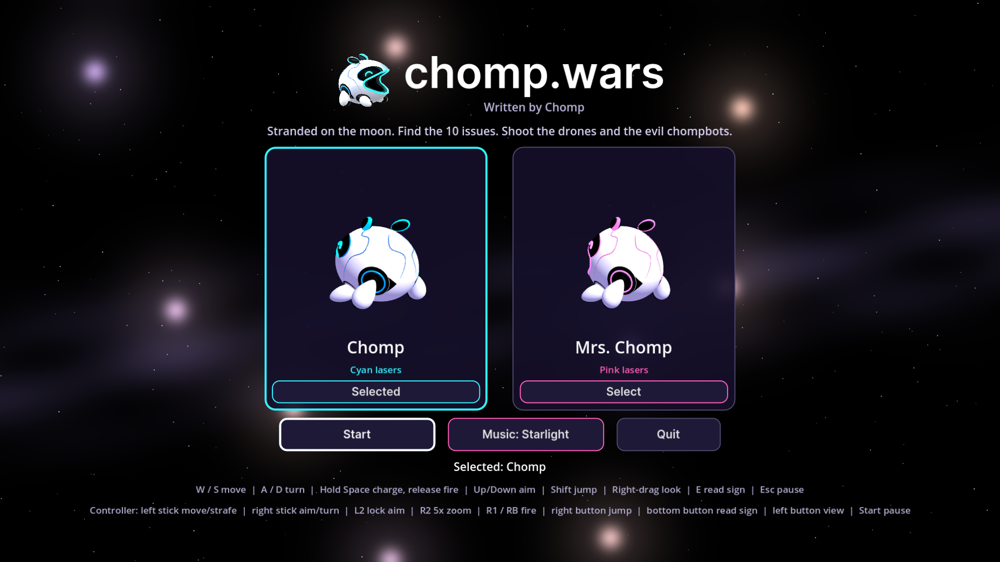
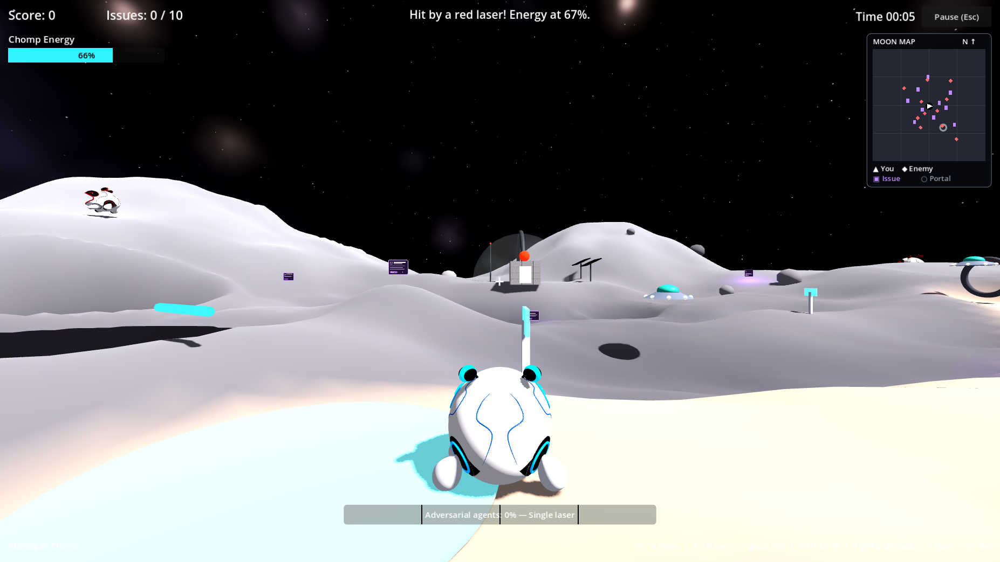
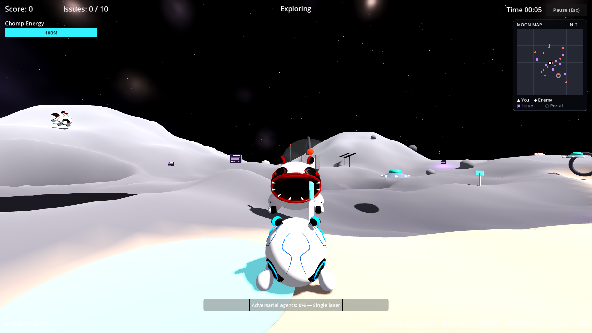

# chomp.wars

Chomp wars is a lunar adventure featuring the Chomp mascot. Written entirely by Chomp: collect issues and shoot the "evil chomps" to get to the final boss!

A small 3D exploration game. You are stranded on a mysterious, low-poly moonscape. Find the 10 hidden magical issues, shoot the hovering drones and the evil chompbots, avoid the water, cliffs and the red lasers, then reach the glowing exit portal. Red lasers drain your Chomp Energy bar, and collecting an issue refills it; run out of energy and the game is over.

Play as **Chomp** (cyan lasers) or **Mrs. Chomp** (the same mascot, recoloured pink, a little slimmer, and pink lasers).

## Screenshots

| Opening screen | Chomp firing a laser |
|---|---|
|  |  |

| Mrs. Chomp firing a laser | An evil chompbot |
|---|---|
|  |  |

The stills show the updated mascot (deep black visor, wheels and ear faces, a solid lip, and a teal glow with a black throat inside the mouth; pink for Mrs. Chomp, red for the evil chompbots). They are in [screencaps](screencaps/). The laser stills place the bolt a few metres out, so it reads clearly in the picture (see [how the stills are made](#regenerate-the-screenshots)).

### Gameplay clip

A 10-second clip of real gameplay (Chomp walking forward and firing), compressed to a small H.264 MP4 with sound: [gameplay-10s.mp4](screencaps/gameplay-10s.mp4).

<video src="screencaps/gameplay-10s.mp4" controls muted width="640"></video>

If the player does not show above, open the [MP4 file](screencaps/gameplay-10s.mp4) directly.

Built with **Godot 4.3** and GDScript.

## Run the game

### Option A: play the exported build

Exported builds are not committed to the repository. Build one yourself (see [Export](#export)).

### Option B: run from source with Godot

1. Install **Godot 4.3** (the project is set up for 4.3; newer 4.x versions usually open it, but 4.3 is what it was tested with). Download it from <https://godotengine.org/download>. On Ubuntu you can also use the Godot download as a single file: unzip it and make it executable.
2. Open Godot and choose **Import**, then select `project.godot` in the repository root.
3. Press **F5** (Run Project).

Or from a terminal, from the repository root:

```bash
godot --path .
```

Use the path to your own Godot binary if `godot` is not on your `PATH`.

**No first-run import step is needed.** The mascot model and the sound files are read directly when the game starts, so a fresh clone runs without opening the project in the editor first. Godot may still create its `.godot/` cache folder; it is git-ignored and safe to delete.

The game opens at 1920 x 1080 with 2x anti-aliasing. On a smaller screen, resize the window or lower the resolution in **Project Settings > Display > Window**.

## Controls

| Key / input | Action |
|---|---|
| W / S | Move forwards / backwards (the character glides forward or back upright, with no tumbling) |
| A / D | Turn the character left / right, all the way round (it leans slightly into the turn) |
| Up / Down | Slowly aim up / down; release to keep that angle |
| Space | Hold to charge up to ten seconds; release to deploy the attack shown in the charge bar. Cyan for Chomp, pink for Mrs. Chomp |
| Shift | Jump |
| Right mouse button, drag | Look around |
| E | Read a signpost (stand near one) |
| V | Switch between third-person (default, the character is visible) and first-person |
| Esc | Pause and resume |
| Mouse | Click the menu and pause buttons |

Look-around uses right-button drag so that the mouse cursor stays free to click the **Pause** button.

### Controller

Keyboard and D-pad movement keep their full forward/backward speed while turning. Keyboard, mouse and controller aiming are 45% slower for finer control.

A wired or Bluetooth controller works alongside the keyboard. Pair it with your system first (on Ubuntu: **Settings > Bluetooth**), then start the game. Godot recognises common controllers such as Xbox, PlayStation and Switch Pro pads. The face buttons below are named by position (top, right, bottom, left), not by the letter or symbol printed on them, so the same layout applies to every controller.

| Controller input | Action |
|---|---|
| Left stick | Move forwards / backwards and strafe left / right |
| D-pad | Move forwards / backwards; left and right turn the character |
| Right stick | Aim up / down and turn left / right |
| L2 / left trigger (hold) | Stand still; left stick aims at twice the normal speed |
| R2 / right trigger (hold) | 5x perspective magnification with five times finer aiming |
| R1 / RB / right shoulder button | Hold to charge, release to fire |
| Right face button | Jump |
| Left face button | Switch between third-person and first-person |
| Bottom face button | Read a signpost. With no signpost nearby, turn to face the camera and chomp |
| Start / Options / + | Pause and resume |
| D-pad or left stick, then bottom face button | Choose a button on the start, pause and victory screens |

## How to play

1. Pick **Chomp** or **Mrs. Chomp** on the start screen (both turn slowly and chomp in their previews). Press **Music** to choose the background music: Starlight (the default), Extra Terrestrial or Hard Rock. Then press **Start**.
2. Walk into the glowing purple backlog cards to collect issues. Each card has an open-issue symbol, title lines and a BACKLOG label. The north-up minimap at the top right shows your heading (white arrow), remaining issues (purple cards), enemies (red diamonds) and the portal (grey ring, mint when open). Your score is at the top left, with the issue counter to its right. Each issue you collect refills your energy to 100%.
3. UFO-shaped saucer drones float over the moonscape, and several small evil chompbots roam the ground. Aim with the crosshair and hold **Space** to charge and release to fire. Each drone or evil chompbot you destroy scores **100 points**; the score is shown at the top left.
4. One laser hit destroys an evil chompbot. They are about two and a half times your size and fire red lasers when you are close. Each red laser hit takes a third of your cyan **Chomp Energy** bar; collecting an issue refills it. Three hits and the run is over. Water sends you back to the starting pad. Cliffs are walls: walk around them. The timer sits next to **Pause**. After two minutes, both gameplay and music speed up.
5. Collecting all 10 issues summons a giant Alien Overlord from the portal, with 30 hitpoints (30 times a regular enemy). A health bar at the top of the screen tracks the alien’s remaining health, and every hit triggers a synthesized alien yell. Hard Rock plays during the fight. The boss cycles through a three-shot aimed spread, a twelve-shot radial barrage and a four-shot tracking burst; below half health it attacks more often. Each attack has an audio cue. The portal stays locked until the alien is defeated; trying it early plays an error cue and pushes you out. Defeat the boss, then walk through the glowing portal to win.
6. On the victory screen, choose **Play Again**, **Main Menu** or **Quit**. It shows your issues, enemies destroyed and score.

Drones do not hurt you. Evil chompbots and their red lasers do: each hit takes a third of your energy, and three hits end the run.

Press the **bottom face button** (or **E**) with no signpost nearby and the character turns half a circle to face the camera, opening its mouth wide and snapping it shut with a chomp sound. Press it again to turn back.

The reflective dome moonbase has an airlock, solar panels and an antenna. Ten tiny Chomps are trapped inside. Aim at the glowing red target on the base and hit it ten times to release them. Moon rocks break when hit by a laser. The dome and airlock are solid, so walk round them.

## Project layout

| Path | What it is |
|---|---|
| `project.godot` | Godot project settings. |
| `scenes/` | The scenes: `MainMenu`, `MainGame`, `Player`, `Orb` (the collectible issue), `Enemy` (the hovering drone), `EvilChompbot`, `EnemyLaser` (the evil chompbots' red lasers), `Laser`, `Environment`, `VictoryScreen`. |
| `scripts/` | GDScript for each scene, plus `game_state.gd` (the global run state, score, sound and music) and `chomp_model.gd` (the shared mascot model, Mrs. Chomp recolour and the chomping mouth). |
| `assets/models/chomp_mascot.glb.bin` | The mascot model, supplied pre-built, with the body baked at each mouth step so the jaw can close. Loaded at run time by `scripts/chomp_model.gd`. |
| `assets/audio/` | Three background music tracks and the sound effects (laser, enemy laser, explosion, collect, jump, chomp; generated, see below). Stored as `.wav.bin` so Godot does not import them; the game reads the WAV data directly. |
| `assets/fonts/` | Inter (Regular and SemiBold), the interface font, with its licence. Stored as `.ttf.bin` for the same reason. |
| `assets/images/` | The Chomp logo for the start screen (the Chomp app's logo, resized to 512 px). |
| `shaders/` | `mouth_interior.gdshader` (the glowing inside of the mascot's mouth), `night_sky.gdshader` (the black sky with stars and galaxies in the game) and `starfield.gdshader` (the same sky on the start screen). |
| `tools/generate_audio.py` | Recreates the audio files from code. Standard-library Python only. |
| `tests/smoke_test.gd` | Automated headless test that plays through the main flow. |
| `tools/capture_screencaps.gd` | Saves the four screenshots in `screencaps/` from the real game (needs a display). |
| `tools/record_gameplay.gd` | Records the 10-second gameplay clip with Godot's movie writer (needs a display). |
| `screencaps/` | The README screenshots and the gameplay clip. |
| `deploy-batocera.sh`, `tools/deploy_batocera.py`, `tools/remote_batocera_setup.sh` | Deploy the game to a Batocera machine (see [Deploy to Batocera](#deploy-to-batocera-steam-system)). |
| `export_presets.cfg` | Export settings for Linux, Windows and macOS. |

The terrain, hills, craters, dark frozen lake, dark pond, moonbase dome, cliffs, rocks, path, signposts, issue spots, drone spots, evil chompbot spots and portal are all built in code (`scripts/environment.gd`). You can change their positions there. The world is 200 m square, with invisible walls at its edge.

## Tests

Run the smoke test from the repository root:

```bash
godot --headless --path . -s res://tests/smoke_test.gd
```

It loads every scene, checks that the player stands on the terrain, walks, turns with A and D, jumps, changes the background music, collects the 10 issues, activates and uses the portal, resets after water, returns from the victory screen, restarts a run, switches to Mrs. Chomp, toggles pause, fires pink lasers, scores drone kills, checks the evil chompbots (roaming, red lasers, one-hit kills, larger than the player), the energy bar (cyan, black text, refilled by an issue) and game over after three laser hits, the HUD layout and time counter, the moonbase, the dark lake and pond (not blue), the few moon rocks, the chomp greeting turn, the music speed control, the sound effects, the invisible world edge and the Space and Shift key bindings. It also sends simulated controller input: every action has a controller binding, the left stick moves, the right stick turns and tilts the view (and ignores small drift), the right face button jumps, the top face button fires, L2 locks movement for faster aiming, R2 zooms 5x, the left face button switches the view, Start pauses, and the bottom face button presses the focused button on the pause menu and start screen. It prints `PASS` or `FAIL` for each check and exits with code 0 when all pass.

The headless run may print `Parameter "m" is null` messages after a scene is removed. These come from Godot's headless renderer and do not affect the result. The test exit code is the thing to check.

## Regenerate the screenshots

The four images in `screencaps/` come from the real game. They need a display (they are not made in headless mode). From the repository root:

```bash
godot --path . -s res://tools/capture_screencaps.gd
```

The script opens the start screen, then stages a Chomp shot, a Mrs. Chomp shot and an evil chompbot facing the camera. It launches the laser at an angle from the side of the character, because a bolt fired straight away from the third-person camera looks like a dot. The bolt is placed a few metres out for the still. Gameplay firing is unchanged. The window size depends on the desktop, so the images may be a little smaller than 1920 x 1080.

## Regenerate the gameplay clip

The clip comes from the real game, with a display and not in headless mode. Godot writes raw frames at a fixed 30 fps to a temporary file outside the repository, then `ffmpeg` trims them to 10 seconds and compresses them. From the repository root:

```bash
godot --path . --fixed-fps 30 --write-movie /tmp/chomp-raw.avi -s res://tools/record_gameplay.gd
ffmpeg -y -i /tmp/chomp-raw.avi -ss 2.6666667 -t 10 -vf "fps=30,scale=1280:720:flags=lanczos" \
  -c:v libx264 -preset slow -crf 28 -pix_fmt yuv420p -c:a aac -b:a 96k -ac 2 -movflags +faststart \
  screencaps/gameplay-10s.mp4
```

The recording starts with Chomp on open ground. The first 2.67 seconds are the scene settling, so the trim starts there. The raw recording contains per-frame warnings from `ffmpeg` about the AVI container. The output is checked by sampling stills, not by the warnings.

## Look, music and credits

- The sky is black, with stars and galaxies. The start screen shows the same sky.
- The start screen has three background music tracks: Starlight, Extra Terrestrial and Hard Rock. The **Music** button cycles through them, and the choice is used for the run. Starlight is the default.
- The interface font is [Inter](https://github.com/rsms/inter), under the SIL Open Font License 1.1. Its licence is in `assets/fonts/Inter-LICENSE.txt`.
- The logo on the start screen is the 3D Chomp mascot logo.
- The game is built with Godot 4.3, which is released under the MIT licence.

## Regenerate the audio (optional)

The sound files are already in `assets/audio/`. To rebuild them:

```bash
python3 tools/generate_audio.py
```

The game reads the WAV files directly and sets the music to loop, so no import setting or editor step is needed.

## Export

Export presets are set up for **Linux (x86_64)**, **Windows Desktop** and **macOS**.

1. In Godot, open **Editor > Manage Export Templates** and install the templates for **4.3** (one-time download, about 1 GB).
2. Choose **Project > Export**, select a preset, and press **Export Project**.

Output goes to `build/` (linux, windows, macOS). This folder is git-ignored.

Things to know before you ship:

- **Linux:** the export is a single executable plus a data file. Keep both in the same folder.
- **Windows:** the `.exe` is unsigned. Windows may show a SmartScreen warning until it is code-signed.
- **macOS:** the export is a `.zip` containing an app. The app is not code-signed or notarised yet. On a Mac that is not your own, you will need to sign and notarise it with an Apple Developer account, or users will see a Gatekeeper warning.

### Deploy to Batocera (Steam system)

To deploy Chomp Wars directly to a Batocera machine and integrate it into the **Steam** system in EmulationStation and Steam Big Picture:

```bash
./deploy-batocera.sh
```

The script will prompt for the Batocera hostname/IP, SSH user, and password (credentials are never stored). It transfers the game files, configures the Godot runtime, exports the release package, configures EmulationStation launcher scripts, sets up hotkeys (**Hotkey + Start** to exit back to Batocera), registers metadata and box art, and triggers a live reload in EmulationStation.

Pass `--skip-tests` for fast iterative redeployment.

## Status and known limits

- The game was checked on Linux with the headless smoke test. The three builds were exported in an earlier pass; they need to be exported again after the drone and laser changes. Windows and macOS builds have **not** been run on those systems yet.
- Frame-rate (60 fps target) has not been measured on real hardware. The start screen now renders two live 3D previews, which adds some cost.
- The mouth closes like a jaw: the top stays fixed and the bottom closes up to it. The model holds the body at 17 mouth steps and the game shows one at a time, so the motion moves in small steps.
- Drones are targets only. They do not damage the player, and there are six of them.
- Evil chompbots are new and have not been playtested. Their size, roaming, red laser speed and the 3-second fire cooldown may need tuning.
- Controller support is tested with simulated input in the headless smoke test only. It has not yet been tried with a physical controller, wired or Bluetooth. Stick look speed and deadzone may need tuning after that.
- Jump moved from Space to Shift, because Space now fires. The original spec gave Space to jump.
- Mrs. Chomp is the same model recoloured and slightly slimmer at runtime. She is not a separately modelled character.
- The default view is third-person so the character is visible. Press V for first-person. The spec asked for first-person; this is a deliberate change.
- Steam is not integrated yet (no Steamworks SDK, achievements, or store pages). The project is structured so that can be added later.

## Credits and licences

- Built with [Godot Engine](https://godotengine.org/) 4.3, which is MIT-licensed. Include Godot's licence notice with any distributed build.
- The mascot model, logo and audio were made for Chomp.

The charge bar has four marked quarters and shows the percentage and attack name. Charge takes ten real-time seconds, even after the game speeds up. Release below 25% for a single laser, at 25–49% for a big beam, at 50–74% for five lasers, or at 75–99% for a circle of 24 lasers limited to fifteen Chomp widths (13.5 metres) from Chomp. At 100%, release for 48 downward beams within twenty Chomp widths (18 metres), twice the previous radius. The bar and companion lights symbolize adversarial agents helping Chomp; this is an in-game metaphor. Pausing or respawning cancels a pending charge.

## Copyright and licence

Copyright (c) 2026 ChompWorks Automation LLC. All rights reserved.

This repository is public for viewing only. No licence is granted to copy, modify, distribute or use any part of it, including the code, artwork, models, audio, and the Chomp name and logo. See [LICENSE](LICENSE).

The Inter font in `assets/fonts/` is a third-party font under the SIL Open Font License 1.1 (see `assets/fonts/Inter-LICENSE.txt`); that licence, not the notice above, applies to the font files.
